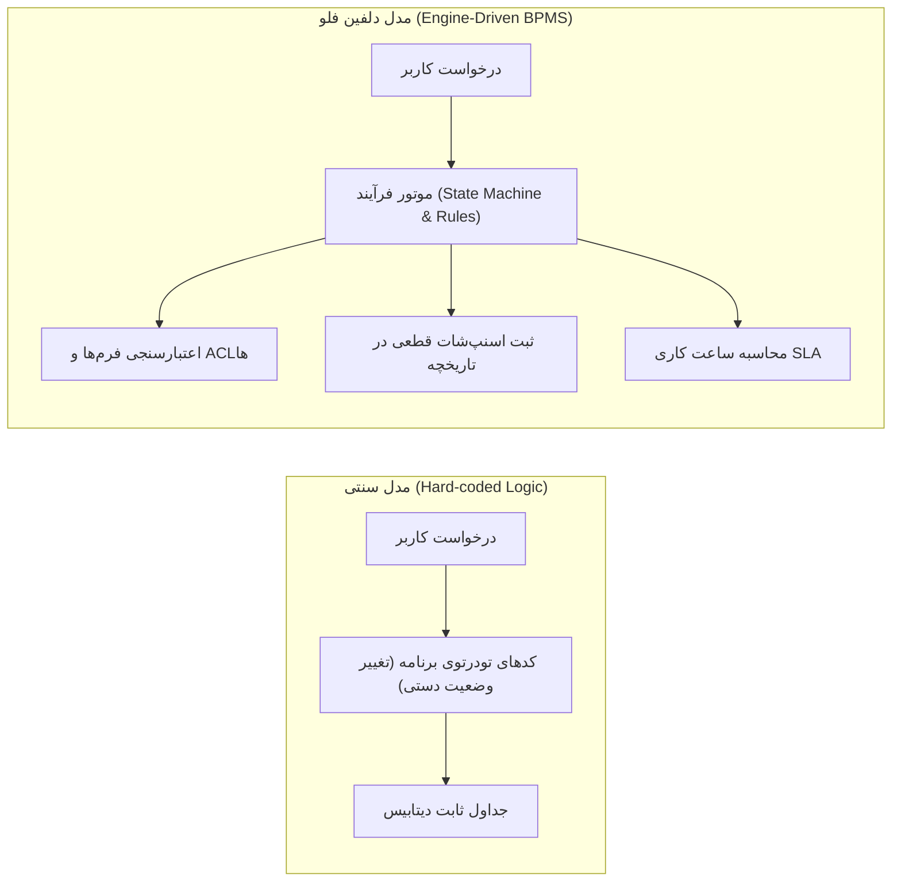
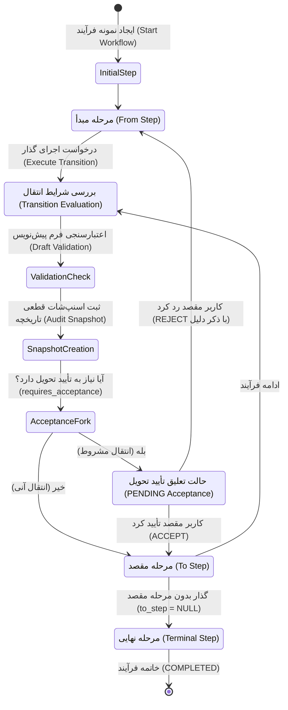
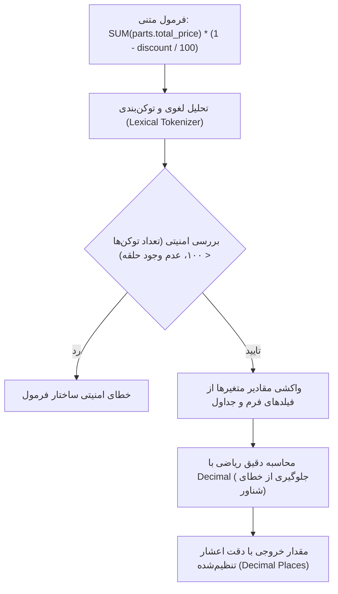
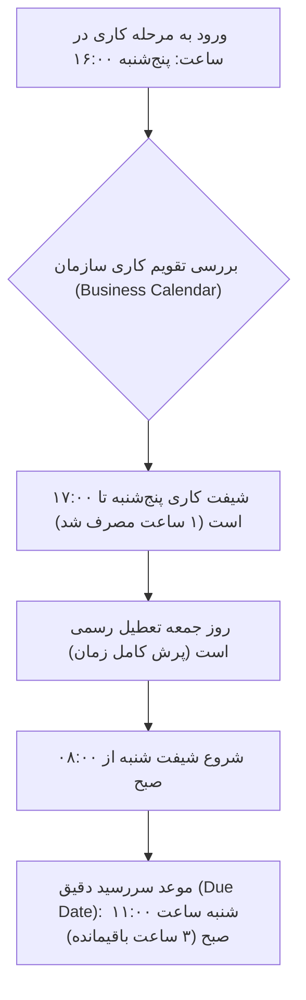

# سند جامع معماری منطقی و قوانین کسب‌وکار سامانه Dolphin Flow
### (Enterprise Business Logic & Domain Architecture Specification)

> **نوع مستند:** سند تحلیل مفهومی و منطق دامنه (Domain Logic Specification)  
> **مخاطب:** تیم فنی، مدیران فرآیند، تحلیل‌گران کسب‌وکار و راهبران سیستم  
> **دامنه سامانه:** BPMS سازمانی و مدیریت گردش کارهای صنعتی/خدماتی  

---

## ۱. فلسفه طراحی و پارادایم بنیادین (Core Architectural Paradigm)

سامانه **Dolphin Flow** بر مبنای اصل **«گردش کار در اولویت» (Workflow-First Design)** توسعه یافته است. در سامانه‌های سنتی سازمانی، منطق‌های کسب‌وکار به صورت شرط‌های تودرتو و سفت‌وسخت درون کدهای نرم‌افزار پنهان شده‌اند. دلفین فلو این ساختار را شکسته و فرآیندها را از داده‌ها تفکیک نموده است:



### ۳ اصل تخطی‌ناپذیر سیستم:
1. **اصالت رویداد (Auditability & Immutability):** هر تصمیمی که در سازمان گرفته می‌شود حکم یک «امضای دیجیتال» را دارد؛ بنابراین رکوردهای ثبت‌شده گذشته به هیچ عنوان ویرایش نمی‌شوند، بلکه فقط رونوشت زمان‌دار جدید ایجاد می‌گردد.
2. **استقلال ساختار فرآیند از فرم‌ها:** هر مرحله از فرآیند می‌تواند فرم، دسترسی‌ها و ناظران متفاوتی داشته باشد بدون این‌که نیاز به تعریف جدول جدید در دیتابیس باشد.
3. **زمان‌بندی سازمانی مبتنی بر شیفت (Business Calendar SLA):** زمان در سازمان ۲۴ ساعته خطی نیست، بلکه مبتنی بر ساعات شیفت کاری، تعطیلات رسمی و تقویم اختصاصی دپارتمان‌ها سنجیده می‌شود.

---

## ۲. منطق موتور گردش کار و ماشین وضعیت (Workflow & State Machine Logic)

فرآیندها در دلفین فلو به صورت یک **گراف جهت‌دار معین (Directed Graph / Finite State Machine)** مدل‌سازی می‌شوند.



### منطق‌های کلیدی گذارها:
* **گذار معمولی (Direct Transition):** انتقال مستقیم از مرحله A به مرحله B همراه با بسته شدن زمان SLA مرحله A و آغاز SLA مرحله B.
* **گذار پایانی (Finish Transition):** گذاری که مرحله مقصد ندارد (`to_step = NULL`). اجرای این گذار وضعیت کل نمونه فرآیند را از `ACTIVE` به `COMPLETED` تغییر می‌دهد و پرونده بسته می‌شود.
* **پروتکل تحویل دومرحله‌ای (Dual-Handoff / Acceptance Protocol):**
  * *مسئله سازمانی:* در فرآیندهای فیزیکی (مثل تحویل یک لپ‌تاپ تعمیری از پذیرش به کارشناس فنی)، پذیرش نباید صرفاً با زدن یک دکمه کار را به گردن تعمیرکار بیاندازد بدون آن‌که تعمیرکار دستگاه را فیزیکی تحویل گرفته باشد.
  * *قانون سیستم:* با زدن گذار، وضعیت گذار `PENDING` می‌شود. فرآیند در مرحله قبلی فریز می‌ماند و در کارتابل گیرنده به عنوان **«در انتظار تایید و تحویل‌گیری»** ظاهر می‌شود. اگر گیرنده دکمه `ACCEPT` را بزند، مسئولیت رسماً منتقل می‌شود؛ اگر `REJECT` کند، با درج علت بازگشت داده می‌شود.

---

## ۳. منطق فرم‌ساز داینامیک و فیلدهای متصل (Dynamic Form & Data Logic)

دلفین فلو به جای فرم‌های هاردکد، از یک معماری چندلایه کامپوننتی برای داده‌ها استفاده می‌کند:

```
┌─────────────────────────────────────────────────────────────┐
│                    تعریف فرم (FormDefinition)               │
├─────────────────────────────────────────────────────────────┤
│  ┌───────────────────────────────────────────────────────┐  │
│  │               بخش‌های فرم (FormSection)              │  │
│  ├───────────────────────────────────────────────────────┤  │
│  │  1. فیلدهای تکی (Normal Fields: متنی، عددی، انتخابی...) │  │
│  │                                                       │  │
│  │  2. جداول تکرارشونده (FormRepeatableGroup):            │  │
│  │     ┌───────────────────────────────────────────────┐ │  │
│  │     │ ردیف ۱: [قطعه] [تعداد] [قیمت] [فرمول جمع]    │ │  │
│  │     │ ردیف ۲: [قطعه] [تعداد] [قیمت] [فرمول جمع]    │ │  │
│  │     └───────────────────────────────────────────────┘ │  │
│  │                                                       │  │
│  │  3. فیلدهای فرمولی تجمیعی (Aggregates):               │  │
│  │     - مجموع هزینه نهایی: SUM(قیمت کل ردیف‌ها)         │  │
│  └───────────────────────────────────────────────────────┘  │
└─────────────────────────────────────────────────────────────┘
```

### دسته‌بندی منطقی انواع فیلدها:
1. **فیلدهای پایه ورودی:** متنی (`TEXT`)، متنی چندخطی (`TEXTAREA`)، عددی (`NUMBER`)، منطقی بله/خیر (`BOOLEAN`) و بارگذاری مستندات (`FILE`).
2. **فیلدهای تقویمی هوشمند (`DATE`, `DATETIME`):**
   * پشتیبانی ذاتاً دوگانه از تقویم **هجری شمسی (جلالی)** و **میلادی**.
   * ذخیره‌سازی استاندارد ISO-8601 در دیتابیس با نمایش و تبدیل معتبر شمسی برای اپراتورها.
3. **فیلدهای انتخابی (`SELECT`):**
   * *Static:* گزینه‌های ثابت درون فرم (مثل: کم، متوسط، زیاد).
   * *Lookup List:* لغت‌نامه‌های سازمانی پویا و قابل مدیریت توسط مدیر سیستم.
   * *Model Query:* اتصال به موجودیت‌های سامانه (مثلاً انتخاب مشتری یا نوع دستگاه).
4. **کلیدهای سیستمی (System Keys Binding):**
   * امکان اتصال یک فیلد فرم به ستون‌های زیرسیستم‌های اصلی (مانند کد IMEI، مدل دستگاه، شرح مشکل، وضعیت گارانتی).
   * *مزیت:* فرم داینامیک است، اما تغییر فیلد IMEI درون فرم به صورت هوشمند بر روی رکورد فیزیکی دستگاه نیز اعمال می‌شود.

---

## ۴. منطق موتور فرمول‌ساز امن (Deterministic Formula Engine)

در فرآیندهای مالی و سازمانی نیاز است مبالغ، دستمزدها، تخفیف‌ها یا مقادیر ریاضی محاسبه شوند. برای جلوگیری از خطرات امنیتی اجرای کدهای پایتون (`eval`)، دلفین فلو مجهز به یک **موتور تجزیه درخت نحوی (Safe AST Evaluator)** است:



### توابع پشتیبانی‌شده:
* **توابع ریاضی پایه:** `ROUND(x, n)`, `FLOOR(x)`, `CEIL(x)`, `ABS(x)`
* **توابع تجمیعی سطرهای تکرارپذیر:**
  * `SUM(group.field)`: جمع یک ستون از جدول
  * `AVG(group.field)`: میانگین مقادیر
  * `MIN(group.field)` و `MAX(group.field)`: کمترین و بیشترین مقدار ثبت‌شده

---

## ۵. منطق تقویم کاری و موتور SLA (Business Calendar & SLA Engine)

محاسبه زمان در سازمان‌ها با سیستم‌های عادی تفاوت دارد. اگر کاری در روز پنجشنبه ساعت ۱۶:۰۰ تحویل داده شود و مهلت SLA آن ۴ ساعت باشد، موعد تحویل نباید پنجشنبه ساعت ۲۰:۰۰ باشد!



### مؤلفه‌های مدل منطقی تقویم:
1. **شیفت‌های هفتگی (`WeeklySchedule` & `WorkingInterval`):** تعریف بازه کاری هر روز (مثلاً شنبه تا چهارشنبه ۸:۰۰ تا ۱۶:۳۰، پنجشنبه‌ها ۸:۰۰ تا ۱۲:۰۰).
2. **استثنائات تقویم (`CalendarException`):**
   * تعطیلات تقویمی رسمی (عید، مناسبت‌ها).
   * روزهای تعطیل غیرمترقبه (آلودگی هوا، برودت هوا).
   * شیفت‌های اضافه کاری خاص دپارتمان.
3. **ماشین مانیتورینگ دوره‌ای (Celery Beat Monitor):**
   * هر ۶۰ ثانیه وضعیت تمام کارهای در جریان را پایش می‌کند.
   * **سبز:** زمان سپری‌شده زیر آستانه هشدار است.
   * **زرد (هشدار سررسید):** ۸۰٪ از مهلت کاری سپری شده است ⬅️ ارسال نوتیفیکیشن هشدار به اپراتور و سرپرست.
   * **قرمز (نقض تعهد / Breached):** مهلت به پایان رسیده ⬅️ ثبت رکورد رسمی تخلف SLA جهت گزارش‌های مدیریتی.

---

## ۶. ماتریس حاکمیت امنیت و دسترسی (Multi-Tier Authorization Matrix)

دلفین فلو از مدل امنیتی ۵ لایه تلفیقی **RBAC + ABAC** با سیاست بنیادین **«رد پیش‌فرض» (Deny by Default)** پیروی می‌کند:

```
               [ درخواست کاربر برای اقدام / مشاهده ]
                                 │
                                 ▼
                     ┌───────────────────────┐
                     │  ۱. آیا صراحتاً DENY  │───────► [ رد قطعی دسترسی ]
                     │  شده است؟             │   بله
                     └───────────────────────┘
                                 │ خیر
                                 ▼
                     ┌───────────────────────┐
                     │  ۲. آیا صراحتاً ALLOW │───────► [ تایید دسترسی ]
                     │  شده است؟             │   بله
                     └───────────────────────┘
                                 │ خیر
                                 ▼
                     ┌───────────────────────┐
                     │  ۳. آیا نقش سازمانی او│───────► [ رد قطعی دسترسی ]
                     │  ممنوع شده است؟       │   بله
                     └───────────────────────┘
                                 │ خیر
                                 ▼
                     ┌───────────────────────┐
                     │  ۴. آیا نقش او مجوز   │───────► [ تایید دسترسی ]
                     │  ALLOW دارد؟          │   بله
                     └───────────────────────┘
                                 │ خیر
                                 ▼
                     ┌───────────────────────┐
                     │  ۵. آیا مالک پرونده   │───────► [ تایید دسترسی مشاهده ]
                     │  است؟ (ضمنی)          │   بله
                     └───────────────────────┘
                                 │ خیر
                                 ▼
                       [ رد پیش‌فرض: عدم دسترسی ]
```

### سطوح مجوزهای فیلد (Field-Level Permissions):
جدا از اینکه کاربر چه نقشی دارد، در هر مرحله از فرآیند مشخص می‌شود فیلدهای فرم در چه حالتی باشند:
* **مخفی (`HIDDEN`):** کاربر اصلاً این فیلد را نمی‌بیند (مثلاً سود قطعه یا یادداشت محرمانه فنی).
* **فقط‌خواندنی (`READONLY`):** کاربر مقدار را می‌بیند اما حق دستکاری ندارد (مثلاً IMEI در مرحله ترخیص).
* **اختیاری (`OPTIONAL`):** کاربر می‌تواند پر کند یا خالی بگذارد.
* **اجباری (`REQUIRED`):** عبور از مرحله بدون پر کردن این فیلد غیرممکن است.

---

## ۷. منطق کارتابل‌های اپراتوری و تجربه کاربری (Worklists & Queues)

برای این‌که پرسنل در میان حجم بالای پرونده‌ها گم نشوند، وظایف در ۵ پوشه کارتابل هوشمند دسته‌بندی می‌شوند:

| کارتابل | مفهوم منطقی | اقدام مورد انتظار |
| :--- | :--- | :--- |
| **فرآیندهای من (My Processes)** | پرونده‌هایی که توسط خود کاربر فعلی استارت خورده‌اند. | پیگیری وضعیت عمومی فرآیندهای آغازشده |
| **وظایف ارجاع‌شده (Assigned Tasks)** | پرونده‌هایی که دقیقاً در مرحله جاری به این کاربر یا نقش او محول شده‌اند. | تکمیل فرم، ارزیابی فنی و زدن دکمه گذار |
| **در انتظار تایید (Pending Acceptances)** | پرونده‌هایی که فرد قبلی برای این کاربر فرستاده ولی هنوز تحویل نگرفته است. | بررسی فیزیکی دستگاه یا پرونده و زدن دکمه `ACCEPT` یا `REJECT` |
| **در انتظار دیگران (Waiting for Others)** | پرونده‌هایی که این کاربر ارسال کرده ولی نفر بعدی هنوز تحویل نگرفته است. | اطلاع از این‌که کار در دست چه کسی متوقف است |
| **فرآیندهای ناتمام (Unfinished Processes)** | دید کلی به تمام فرآیندهای باز سازمان که کاربر مجوز دیدنشان را دارد. | نظارت مدیریتی بر جریان عمومی سازمان |

### منطق رویدادهای بلادرنگ (Real-time Live Events):
* هر تغییری در وضعیت نمونه یا تحویل گذارها رخ دهد، از طریق **WebSocket (Daphne + Redis)** به مرورگر اپراتور پیام فرستاده شده و شمارنده‌های سایدبار و ردیف‌های جدول **بدون رفرش صفحه** آپدیت می‌شوند.

---

## ۸. منطق بایگانی حقوقی و اسنپ‌شات تاریخچه (Immutable Audit Ledger)

در سامانه‌های Enterprise، اگر فرم ۲ سال بعد بازطراحی شود، پرونده ۲ سال پیش نباید با فرمت جدید نمایش داده شود یا با خطای فیلد حذف‌شده مواجه شود!

* **قانون اسنپ‌شات منجمد:** در لحظه زدن دکمه ثبت هر مرحله، یک کپی ساخت‌یافته JSON شامل:
  * نام و شناسه اقدام‌کننده و زمان دقیق سرور
  * تمام مقادیر فیلدها در همان ثانیه
  * تمام سطرهای جداول تکرارپذیر و محاسبات فرمولی
  * فایل‌های پیوست و وضعیت شناسه‌های دستگاه
  تولید شده و در جدول تاریخچه قفل می‌شود. این داده هرگز دستخوش تغییرات طرح‌واره (Schema Migration) نخواهد شد.

---

## ۹. جمع‌بندی ساختار پیاده‌سازی‌شده

این پلتفرم به جای اتکای صِرف بر کدهای سنتی جنگو، به یک **سیستم‌عامل فرآیندی کامل (Enterprise Process Operating Engine)** مجهز شده است که توانایی پیاده‌سازی هر نوع فرآیند سازمانی (تعمیرات، انبارداری، صدور اسناد مالی، مرخصی پرسنل، گردش نامه‌ها) را بدون دستکاری در کدهای پایه فراهم می‌آورد.
