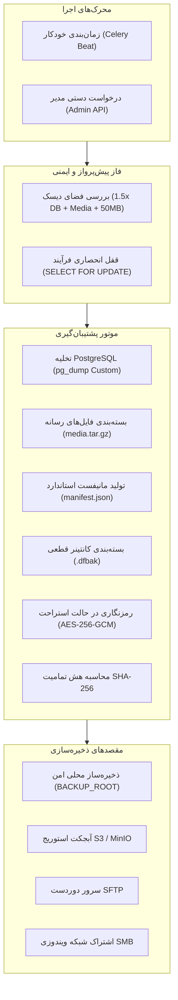
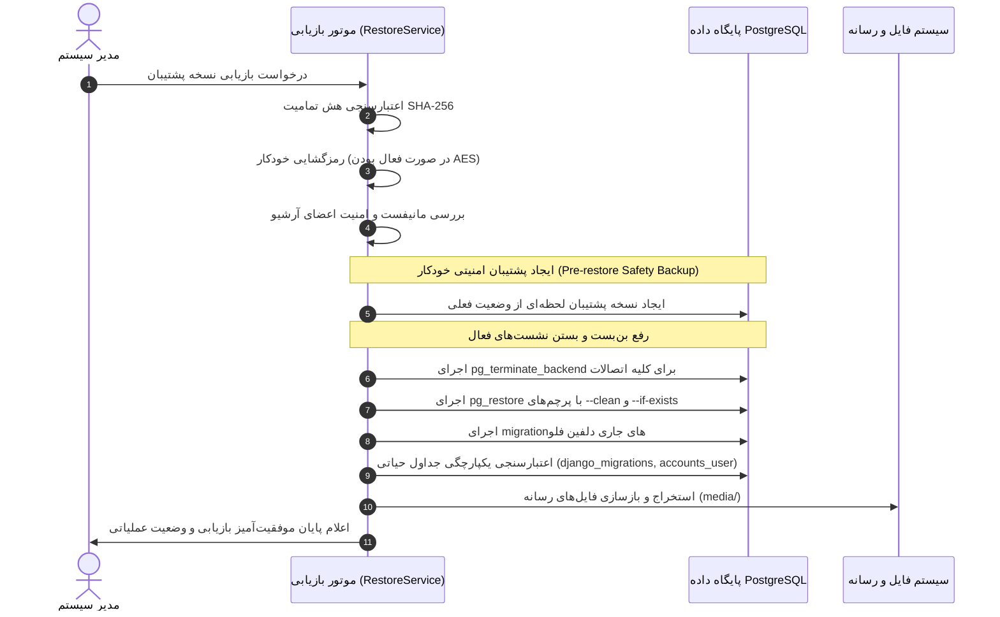

# سامانه جامع پشتیبان‌گیری و بازیابی اطلاعات Dolphin Flow
## راهنمای فنی، معماری و دستورالعمل اجرایی عملیات بازیابی (Disaster Recovery Runbook)

**نسخه مستند:** 2.0.0  
**وضعیت:** اجرایی سازمانی (Enterprise Production Standard)  
**تاریخ به‌روزرسانی:** پاییز ۱۴۰۵  

---

## ۱. مقدمه و معماری کلان (Architecture & Core Principles)

سامانه پشتیبان‌گیری و بازیابی دلفین فلو (Dolphin Flow Backup & Restore Subsystem) به عنوان لایه دفاعی اصلی حفظ تداوم کسب‌وکار، تضمین تمامیت داده‌ها و احیای سامانه پس از بحران طراحی شده است. این زیرسیستم با تکیه بر استانداردهای سازمانی و الگوهای قطعی (Deterministic & Atomic Operations)، کلیه داده‌های رابطه‌ای پایگاه داده PostgreSQL، فایل‌های پیوست و رسانه‌ای فرم‌های فرآیندی و متادیتاهای وضعیتی را در قالب بسته‌های بایگانی استاندارد `dfbak.` ذخیره، اعتبارسنجی و نگهداری می‌کند.



---

## ۲. فرمت فایل کانتینر پشتیبان (`.dfbak`)

هر نسخه پشتیبان یک کانتینر بایگانی استاندارد با پسوند `.dfbak` است که به صورت کامپکت و ایزوله شامل اجزای زیر می‌باشد:

| نام عضو داخل بایگانی | نوع و ماهیت | توضیحات |
| :--- | :--- | :--- |
| `manifest.json` | متادیتای سیستم | حاوی مشخصات زمان ایجاد، نسخه نرم‌افزار، هش داده‌ها، وضعیت رسانه‌ها و مشخصات ساختار موتور PostgreSQL |
| `database.dump` | باینری PostgreSQL | خروجی خام و سفارشی `pg_dump` در فرمت باینری فشرده (`-Fc`) با قابلیت بازسازی موازی و قطعی |
| `media.tar.gz` | آرشیو پیوست‌ها | بایگانی فشرده دایرکتوری `media/` شامل مستندات فرآیندها، امضاهای دیجیتال و پیوست‌های کاربران |

> [!IMPORTANT]
> نام‌گذاری فایل‌ها به صورت قطعی و امن با الگوی استاندارد `DolphinFlow_Backup_YYYY-MM-DD_HHMMSS.dfbak` تولید می‌شود. سامانه از ورود کاراکترهای خطرناک یا پیمایش دایرکتوری (`../`) به شدت جلوگیری می‌کند.

---

## ۳. لایه امنیت و رمزنگاری در حالت استراحت (AES-256-GCM)

جهت تضمین محرمانگی در فضاهای ابری نامطمئن و سرورهای اشتراکی شبکه، کلیه فایل‌های پشتیبان مجهز به رمزنگاری با استاندارد صنعتی **AES-256-GCM** هستند:

* **هدر شناسایی جادویی:** ابتدای فایل‌های رمزنگاری شده دارای پیشوند ۱۶ بایتی `DFBAK_ENC_V1\x00\x00\x00\x00` است.
* **نانس تصادفی امن (Nonce):** به ازای هر عملیات رمزنگاری، یک نانس منحصربه‌فرد ۱۲ بایتی (۹۶ بیت استاندارد GCM) به روش کریپتوگرافیک تصادفی تولید می‌شود.
* **احراز اصالت داده (AEAD):** تگ احراز اصالت در انتهای متن رمزنگاری شده ذخیره می‌شود تا کوچک‌ترین دستکاری یا تغییر بیت‌ها در زمان بازیابی فورا شناسایی و مسدود گردد.
* **مدیریت کلید (Key Management):** کلید رمزنگاری از طریق متغیر محیطی `BACKUP_ENCRYPTION_KEY` دریافت شده و در صورت عدم تنظیم، با الگوریتم هش یک‌طرفه SHA-256 از کلید سازمانی `SECRET_KEY` مشتق می‌شود.
* **سازگاری با گذشته (Backward Compatibility):** سیستم به صورت شفاف فایل‌های قدیمی یا بدون رمزنگاری را شناسایی کرده و فرآیند بازیابی یا بررسی مانیفست بدون اختلال روی آن‌ها اجرا می‌شود.

---

## ۴. کنترل‌های پیش‌پرواز و ایمنی فضای دیسک (Pre-flight Disk Check)

پیش از تخصیص حافظه موقت و اجرای `pg_dump`، سامانه ظرفیت دیسک مقصد را بر اساس فرمول سخت‌گیرانه زیر ارزیابی می‌کند:

$$\text{Required Space} = (1.5 \times \text{Database Size}) + \text{Media Directory Size} + 50\,\text{MB}$$

* حجم جاری پایگاه داده مستقیماً از طریق تابع داخلی موتور `()SELECT pg_database_size(current_database)` استعلام می‌شود.
* چنانچه فضای آزاد دیسک سرور از مقدار محاسبه‌شده کمتر باشد، فرآیند فوراً با خطای واضح فارسی متوقف شده و از پر شدن هارد سرور و کرش کردن سیستم جلوگیری به عمل می‌آید.

---

## ۵. پشتیبانی جامع از مقصدهای ذخیره‌سازی شبکه و ابر (Storage Drivers)

سامانه علاوه بر ذخیره‌ساز محلی، امکان همگام‌سازی همزمان یا ذخیره اختصاصی روی چهار نوع مقصد شبکه را داراست:

### ۱. آبجکت استوریج S3 / MinIO
* سازگار با پروتکل استاندارد AWS S3، سرویس ابری آروان‌کلود، MinIO درون‌سازمانی و Ceph.
* پشتیبانی از Endpoint سفارشی (Host + Port)، تعیین منطقه (Region) و احراز هویت امضای Signature Version 4.
* ارسال امن مستقیم فایل‌ها بدون افشای کلیدهای Secret Access Key در گزارش‌ها.

### ۲. سرور امن SFTP / SSH
* انتقال فایل‌ها روی کانال رمزنگاری‌شده SSH به سرورهای لینوکسی و بک‌آپ استوریج‌های راه دور.
* ساخت سلسله‌مراتبی و خودکار پوشه‌های والد در مقصد دوردست.

### ۳. اشتراک فایل ویندوزی SMB / CIFS
* اتصال به سرورهای فایل ویندوزی و دستگاه‌های NAS سازمانی (پورت ۴۴۵).
* مدیریت خودکار نشست‌های احراز هویت.

### ۴. پوشه‌های Mount شده محلی (Mounted Volume)
* سازگار با استوریج‌های شبکه که در سطح سیستم‌عامل روی یک مسیر مشخص مانت شده‌اند.

---

## ۶. سیاست نگهداری و پاک‌سازی هوشمند (Automated Retention Policy)

مدیریت چرخه‌حیات نسخه‌های پشتیبان از طریق سیاست نگهداری سراسری کنترل می‌شود:

* **نگهداری آخرین نسخه‌ها (`keep_last`):** همیشه تعداد $N$ نسخه موفق آخر حتی در صورت کهنگی حفظ می‌شوند.
* **نگهداری بر اساس سن (`keep_days`):** پشتیبان‌های قدیمی‌تر از تعداد روزهای مشخص شده که خارج از سهمیه `keep_last` باشند، به طور خودکار حذف می‌شوند.
* **قفل ایمنی مقصدهای ترکیبی (Dual-Destination Safety):** پشتیبان‌هایی که مقصد آن‌ها "محلی + شبکه" است، تا زمانی که نسخه شبکه آن‌ها با موفقیت انتقال نیافته باشد، هرگز توسط سیاست نگهداری حذف نخواهند شد.

---

## ۷. چرخه بازیابی امن و ضدبن‌بست (Disaster Recovery Runbook)

عملیات بازیابی اطلاعات (`Restore Pipeline`) یک عملیات حساس و تخریبی است که با تمهیدات سخت‌گیرانه فیل‌سیف طراحی شده است:



### گام‌های بازیابی از طریق پنل مدیریت دلفین فلو:
1. ورود به مسیر مدیریت: **پشتیبان‌گیری ← پشتیبان‌گیری‌ها**.
2. انتخاب رکورد پشتیبان مورد نظر و کلیک بر روی گزینه **بازیابی این پشتیبان**.
3. بازبینی صفحه پیش‌نمایش (شامل نسخه نرم‌افزار، تعداد جداول، حجم دیتابیس و تاریخچه).
4. تایید نهایی بازیابی. سامانه به صورت خودکار یک نسخه ایمنی (`Pre-restore Backup`) تولید کرده، اتصالات مزاحم را قطع نموده و دیتابیس را بازنشانی می‌کند.

### راهنمای بازیابی اضطراری در شرایط خط فرمان (CLI Recovery):
چنانچه پنل وب در دسترس نباشد، بازیابی مستقیم از طریق محیط کانتینر یا خط فرمان سرور انجام می‌پذیرد:

```bash
# ۱. استخراج محتویات بسته پشتیبان
tar -xf DolphinFlow_Backup_2026-10-30_120000.dfbak -C /tmp/restore_staging/

# ۲. بازگردانی دیتابیس به PostgreSQL
docker compose exec -T postgres pg_restore \
    -U dolphin -d dolphinflow \
    --clean --if-exists --no-owner --no-privileges \
    < /tmp/restore_staging/database.dump

# ۳. بازسازی فایل‌های پیوست رسانه‌ای
tar -xzf /tmp/restore_staging/media.tar.gz -C backend/media/

# ۴. اعمال مهاجرت‌های هماهنگ‌سازی پایگاه داده
docker compose exec -T web python manage.py migrate
```

---

## ۸. سامانه هشداردهی آنی و پایش رویدادها (Real-Time Alerting)

در هنگام بروز هرگونه اختلال در فرآیند پشتیبان‌گیری، بازیابی یا همگام‌سازی شبکه:
1. بلافاصله رویداد بحرانی از نوع `BACKUP_ALERT` در دیتابیس ثبت می‌شود.
2. از طریق سوکت وب کانا‌ل‌های سیستمی (`WebSockets`) پیام هشدار زنده به پنل کلیه کاربران ارشد و مدیران سیستم ارسال می‌گردد.
3. جزئیات پیام خطا به صورت کامپکت و کاملاً بهداشتی‌سازی شده (Sanitized بدون نشت رمزها و نام‌های کاربری) در دسترس قرار می‌گیرد.
